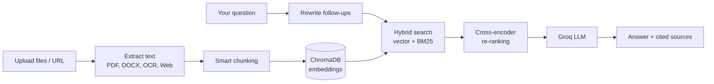

<div align="center">

# 📚 Personal RAG

**Chat with your own documents. Private, fast, and free to run.**

Upload PDFs, Word files, scans, images, or web pages, then ask questions in plain language and get answers with page-level citations.


</div>

<!--
Add a screenshot or GIF of the app here, then remove this comment:


Add a live demo badge if your app is public:
[](https://your-app-name.streamlit.app)
-->

---

## Overview

**Personal RAG** is a Retrieval-Augmented Generation app that answers questions using *only your own documents*, so responses stay grounded in your content instead of the model's guesses. Every answer shows its sources, down to the page number, so you can verify it in seconds.

It combines meaning-based search, keyword search, and a re-ranking model for accurate retrieval, and uses Groq's free API tier for fast answer generation.

## Features

| | Feature | Details |
|---|---|---|
| 📄 | **Many sources** | PDF, DOCX, TXT, Markdown, PNG/JPG images, and web page URLs |
| 🔍 | **OCR built in** | Scanned PDF pages and images are read automatically |
| ✂️ | **Smart chunking** | Splits by paragraph and sentence, keeps headings attached to their text |
| 🧠 | **Hybrid search** | Combines semantic (vector) and keyword (BM25) search with rank fusion |
| 🎯 | **Re-ranking** | A cross-encoder re-scores candidates so the best passages reach the model |
| 💬 | **Chat memory** | Follow-up questions like "explain that more simply" work naturally |
| 📌 | **Cited answers** | Sources shown as `report.pdf (p. 3, 12)` with the exact retrieved passages |
| 🗂️ | **File manager** | See every indexed file and delete any of them individually |
| 💾 | **Saved history** | Conversations persist between sessions; download them as Markdown |
| 🆓 | **Free to run** | Local embeddings and re-ranker, plus Groq's free API tier |

## How it works



1. **Ingest:** text is extracted (with OCR for scanned pages), split into ~1,000-character chunks with overlap, embedded, and stored locally in ChromaDB with source and page metadata.
2. **Understand the question:** follow-ups are rewritten into standalone questions using recent chat history.
3. **Retrieve:** vector search and BM25 keyword search each return 15 candidates, merged with reciprocal rank fusion.
4. **Re-rank:** a cross-encoder scores each candidate against the question and keeps the best 5.
5. **Generate:** the model answers using only those passages, and the app shows the sources.

## Tech stack

| Layer | Technology |
|---|---|
| Interface | [Streamlit](https://streamlit.io) |
| Vector store | [ChromaDB](https://www.trychroma.com) (persistent, local) |
| Embeddings | `all-MiniLM-L6-v2` via Sentence-Transformers |
| Keyword search | `rank-bm25` |
| Re-ranker | `cross-encoder/ms-marco-MiniLM-L-6-v2` |
| LLM | [Groq](https://groq.com) (`openai/gpt-oss-120b`, falls back to `openai/gpt-oss-20b`) |
| Document parsing | `pypdf`, `python-docx`, `BeautifulSoup` |
| OCR *(optional)* | `rapidocr-onnxruntime`, `pypdfium2` |

## Quick start

### Prerequisites

- Python 3.12
- A free Groq API key from [console.groq.com](https://console.groq.com)

### Run locally

```bash
# 1. Clone the repo
git clone https://github.com/Poojarivenkataramana/personal-rag.git
cd personal-rag

# 2. Create and activate a virtual environment
python -m venv myenv
source myenv/bin/activate          # Windows: myenv\Scripts\activate

# 3. Install dependencies
python -m pip install -r requirements.txt

# 4. Set your API key
export GROQ_API_KEY="your-key-here"   # Windows: set GROQ_API_KEY=your-key-here

# 5. Launch
python -m streamlit run main.py
```

The app opens at `http://localhost:8501`. If you skip step 4, paste the key into the sidebar instead.

> **Note:** the first question is slower because the embedding and re-ranking models download once (about 180 MB in total).

## Usage

1. **Add content:** upload files in the sidebar and click **Index files**, or paste a URL and click **Index web page**.
2. **Ask:** type a question in the chat box.
3. **Verify:** check the sources under each answer, or open **Retrieved passages** to read the exact text used.
4. **Manage:** delete individual files from the **Your files** list, start a **New chat**, or **Download chat** as Markdown.

Turn off **Advanced search** in the sidebar for faster (but less precise) retrieval.

## Configuration

Settings live at the top of `main.py`:

| Setting | Default | Purpose |
|---|---|---|
| `MODELS` | `gpt-oss-120b`, `gpt-oss-20b` | Groq models, tried in order |
| `CHUNK_SIZE` | `1000` | Target characters per chunk |
| `CHUNK_OVERLAP` | `150` | Characters shared between neighbouring chunks |
| `CANDIDATES` | `15` | Passages gathered before re-ranking |
| `TOP_K` | `5` | Passages sent to the model |
| `MEMORY_MESSAGES` | `6` | Recent messages the model remembers |

The API key is read from, in order: Streamlit secrets, the `GROQ_API_KEY` environment variable, or the sidebar field.

## Deploy on Streamlit Community Cloud

1. Push `main.py` and `requirements.txt` to a GitHub repository.
2. Go to [share.streamlit.io](https://share.streamlit.io), click **Create app**, and select the repo, branch `main`, and file `main.py`.
3. Under **Advanced settings**, choose Python 3.12 and add your key as a secret:
   ```toml
   GROQ_API_KEY = "your-key-here"
   ```
4. Click **Deploy**.

**Before sharing the link:** restrict access in **Settings → Sharing**. A public deployment shares one document index and one saved chat between all visitors and uses your API key.

## Project structure

```
personal-rag/
├── main.py            # Entire app: ingestion, search, re-ranking, chat UI
├── requirements.txt   # Python dependencies
└── README.md
```

Runtime data (`chroma_db/`, `chat_history.json`) is created automatically and should stay out of version control.

## Limitations

- **Free hosting limits:** Streamlit Community Cloud has limited memory, and this app loads two search models. If it runs out of memory, remove the OCR packages from `requirements.txt` and turn off Advanced search.
- **Storage may reset:** on hosted deployments, indexed documents can be lost when the app restarts, so you may need to re-upload.
- **OCR quality:** works best on clean, printed text. Handwriting and low-quality scans may be misread.
- **Single shared index:** there are no user accounts, so everyone using one deployment sees the same documents.

## Troubleshooting

<details>
<summary><b>Model not found (404) error</b></summary>

Groq retires models from time to time. Check [console.groq.com/docs/models](https://console.groq.com/docs/models) and update the `MODELS` list in `main.py`.
</details>

<details>
<summary><b>ModuleNotFoundError after installing requirements</b></summary>

`pip` and `streamlit` are using different Python installs. Run both through the same Python:

```bash
python -m pip install -r requirements.txt
python -m streamlit run main.py
```
</details>

<details>
<summary><b>Scanned PDFs or images return no text</b></summary>

OCR packages are missing. Install them with `python -m pip install rapidocr-onnxruntime pypdfium2`, then re-index the file.
</details>

<details>
<summary><b>Invalid TOML when adding secrets</b></summary>

Values must be quoted: `GROQ_API_KEY = "your-key-here"`.
</details>

## Roadmap

- [ ] User accounts and per-user document collections
- [ ] Streaming source highlights inside the original PDF
- [ ] Support for more file types (PPTX, XLSX, EPUB)
- [ ] Optional local LLM mode with Ollama
- [ ] Evaluation dashboard for retrieval quality

## Security

Never commit API keys. Keep your key in Streamlit secrets or an environment variable, and keep `chroma_db/` and `chat_history.json` out of Git.

---

<div align="center">

Built with Python, Streamlit, ChromaDB, and Groq.

</div>
